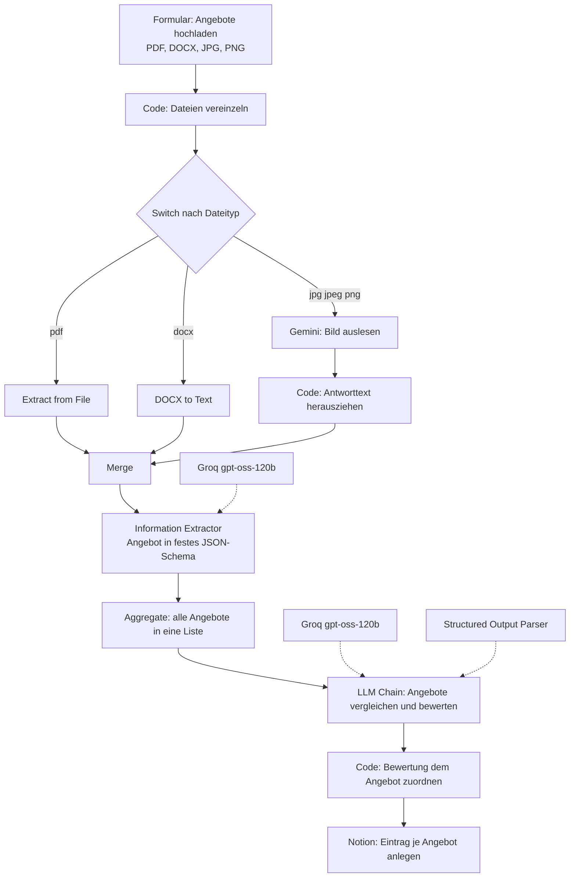

# Angebotsanalyse mit KI

Ein n8n-Workflow, der eingehende Angebote in verschiedenen Dateiformaten ausliest, in eine einheitliche Struktur bringt, miteinander vergleicht und das Ergebnis als Tabelle in Notion ablegt. Entstanden im Rahmen der Weiterbildung zum KI-Integrationsmanager (IHK).

## Projektziel

Wer eine Leistung ausschreibt, bekommt die Angebote in allem, was es gibt: als PDF, als Word-Datei, als abfotografiertes Blatt Papier. Um sie zu vergleichen, muss man sie zuerst von Hand in eine gemeinsame Form bringen, und das ist der Teil, der Zeit kostet und bei dem Fehler entstehen.

Schwieriger als der Preisvergleich ist dabei der Leistungsvergleich. Zwei Angebote mit ähnlicher Summe können einen völlig unterschiedlichen Umfang haben, weil das eine Material enthält und das andere nicht, oder weil eine Position schlicht fehlt. Genau das übersieht man beim Überfliegen, und genau das wird später teuer.

Der Workflow nimmt beide Schritte ab. Er liest jedes Angebot aus, egal in welchem Format es ankommt, überführt es in ein festes Schema mit vereinheitlichten Leistungsbezeichnungen, und lässt anschließend ein Modell alle Angebote gegeneinander bewerten. Die Bewertung benennt ausdrücklich fehlende Angaben und weist darauf hin, wenn Angebote gar nicht sinnvoll vergleichbar sind.

## Verwendete Tools

| Baustein | Eingesetzt wofür |
|---|---|
| n8n (lokal in Docker) | Ablaufsteuerung, alle Knoten |
| Formular-Trigger | Upload der Angebote, mehrere Dateien gleichzeitig |
| Code-Knoten (JavaScript) | Dateien vereinzeln, Modellantwort auspacken, Ergebnisse zusammenführen |
| Switch | Verzweigung nach Dateityp |
| Extract from File | Textextraktion aus PDF |
| DOCX to Text | Textextraktion aus Word-Dateien (Community-Node) |
| Google Gemini, `gemini-3.1-flash-lite` | Auslesen gescannter und fotografierter Angebote |
| Merge | Zusammenführen der drei Eingangswege |
| Information Extractor | Überführung in ein selbst definiertes JSON-Schema |
| Groq, `openai/gpt-oss-120b` | Modell für Extraktion und Bewertung |
| Aggregate | Bündelung aller Angebote für den Vergleich |
| Basic LLM Chain | Bewertung der Angebote gegeneinander |
| Structured Output Parser | erzwingt die Bewertung im vorgegebenen Schema |
| Notion | Ablage als Datenbankeinträge |

## Voraussetzungen

Damit der importierte Workflow läuft, werden vier Dinge gebraucht.

**Community-Node.** `n8n-nodes-docx-converter` ist kein Standardknoten von n8n und muss nachinstalliert werden, in n8n unter *Settings*, *Community Nodes*. Ohne ihn lässt sich der Zweig für Word-Dateien nicht ausführen.

**Zugangsdaten.** Ein Google-Gemini-Zugang für das Auslesen der Bilder, ein Groq-Zugang für Extraktion und Bewertung, ein Notion-Integrationstoken für die Ablage. Im Workflow-Export stehen nur die Verweise auf diese Einträge, keine Schlüssel. Nach dem Import müssen die drei Credentials neu zugeordnet werden.

**Notion-Datenbank.** Die Zieldatenbank heißt „Angebotszusammenfassung" und braucht die folgenden Eigenschaften, mit genau diesen Namen und Typen: Anbieter als Titel, Angebotsdatum als Datum, Gesamtpreis und Rang als Zahl, Bewertung als Auswahl mit den Werten Empfohlen, Neutral und Ablehnen, sowie Projekt, Leistungen, Währung, Ausführungszeitraum, Hinweise, Stärken, Schwächen, Auffälligkeiten und Begründung als Text.

**Hinweis zur Datenbank-ID.** Der Notion-Knoten im Export zeigt auf eine bestimmte Datenbank. Beim Nachbau muss dort die eigene ausgewählt werden.

## Workflow

**1. Daten empfangen.** Ein Webformular nimmt die Angebote entgegen und akzeptiert PDF, DOCX, JPG und PNG. Mehrere Dateien in einem Durchgang sind möglich, denn nur dann gibt es überhaupt etwas zu vergleichen.

**2. Vereinzeln.** Der erste Code-Knoten löst die hochgeladenen Dateien aus dem gemeinsamen Item heraus und erzeugt je Datei ein eigenes Item mit Dateiname, MIME-Typ und Dateiendung. Erst danach kann jede Datei ihren eigenen Weg nehmen.

**3. Verzweigung nach Format.** Der Switch schickt jede Datei auf einen von drei Wegen. PDF geht an die Textextraktion, DOCX an den Konverter, Bilddateien an Gemini. Für die Bilder gibt es keinen regelbasierten Weg, weil ein Foto keinen Text enthält, den man herauslösen könnte.

**4. Bilder auslesen.** Gemini bekommt das Bild und die Anweisung, den vollständigen Text zu übernehmen, Namen, Daten, Positionen und Preise möglichst exakt, und nichts zu ergänzen. Ein zweiter Code-Knoten holt den Text aus der verschachtelten Antwortstruktur heraus, damit er dieselbe Form hat wie die beiden anderen Wege.

**5. Zusammenführen.** Der Merge-Knoten mit drei Eingängen bringt die Wege wieder zusammen. Ab hier ist jedes Angebot nur noch Text, unabhängig davon, woher es kam.

**6. Strukturieren.** Der Information Extractor überführt jedes Angebot in ein selbst geschriebenes JSON-Schema mit Anbieter, Angebotsdatum, Projekt, einer Liste von Leistungen mit Einzelpreisen, Gesamtpreis, Währung, Ausführungszeitraum und Hinweisen. Jede Leistung bekommt zusätzlich eine vereinheitlichte Vergleichsbezeichnung, damit inhaltlich gleiche Positionen aus verschiedenen Angeboten erkennbar werden. Der Systemprompt verbietet ausdrücklich das Erfinden von Angaben und schreibt `null` vor, wo etwas fehlt.

**7. Bewerten.** Aggregate bündelt alle Angebote zu einer Liste, und eine LLM Chain vergleicht sie gegeneinander. Die Bewertung berücksichtigt Preis, Leistungsumfang, fehlende Angaben, Ausführungszeitraum, Zusatzkosten und Risiken. Die Regeln im Prompt halten ausdrücklich fest, dass ein niedriger Preis allein keine Empfehlung rechtfertigt und dass fehlende Vergleichbarkeit benannt werden muss. Jedes Angebot erhält einen Status und einen Rang, dazu Stärken, Schwächen, Auffälligkeiten und eine Begründung. Ein Structured Output Parser erzwingt auch hier das Schema.

**8. Zuordnen und speichern.** Der letzte Code-Knoten führt jedes extrahierte Angebot mit seiner Bewertung zusammen, über den Anbieternamen als Schlüssel, und flacht die Listenfelder für die Ablage ab. Der Notion-Knoten legt daraus je Angebot einen Datenbankeintrag an.

## Screenshots

<!-- Screenshots hier einfügen: Bild per Drag and Drop in den GitHub-Editor ziehen, GitHub erzeugt den Link automatisch. -->

## Herausforderungen

**Drei Eingangsformate, ein Ablauf.** Die eigentliche Schwierigkeit lag nicht im KI-Teil, sondern davor. PDF, Word und Bild brauchen drei verschiedene Verfahren, sollen danach aber identisch weiterbehandelt werden. Gelöst wurde das mit Switch und Merge als Paar: aufteilen, jedes Format auf seinem Weg behandeln, zusammenführen. Der Merge-Knoten musste dafür auf drei Eingänge gestellt werden.

**Mehrere Dateien in einem Item.** Ein Formular-Upload liefert alle Dateien gebündelt in einem einzigen Item mit mehreren Binärfeldern. Der Switch kann damit nichts anfangen, weil er je Item nur eine Entscheidung trifft. Der erste Code-Knoten läuft deshalb über die Binärfelder und erzeugt je Datei ein eigenes Item samt Dateiendung, nach der dann verzweigt wird.

**Die Antwortstruktur des Bildmodells.** Gemini liefert seinen Text nicht als einfaches Feld, sondern verschachtelt unter `content.parts[0].text`. Der zweite Code-Knoten packt ihn aus und legt ihn als `text` ab, damit der Merge-Knoten drei gleich aufgebaute Eingänge bekommt. Dass die drei Wege dieselbe Feldstruktur liefern müssen, war der Punkt, an dem der Workflow zunächst scheiterte.

**Vergleichbarkeit von Leistungen.** Zwei Angebote beschreiben dieselbe Arbeit selten mit denselben Worten. Deshalb enthält das Schema neben der wortgetreuen Beschreibung eine zusätzliche vereinheitlichte Vergleichsbezeichnung. Erst dadurch kann die spätere Bewertung erkennen, ob eine Position in einem Angebot fehlt oder nur anders heißt.

**Bewertung und Angebot wieder zusammenbringen.** Die Bewertung entsteht in einem eigenen Modellaufruf über alle Angebote hinweg und kommt als ein einzelnes Ergebnis zurück. Für die Ablage muss sie aber wieder je Angebot vorliegen. Der letzte Code-Knoten greift dafür über `$('Aggregate')` auf die ursprünglichen Daten zurück und ordnet jeder Bewertung ihr Angebot über den Anbieternamen zu, mit Normalisierung von Groß- und Kleinschreibung.

**Halluzinationen eindämmen.** Beide Prompts enthalten ausdrückliche Verbote: keine Angaben erfinden, Preise nur übernehmen, wenn sie eindeutig dastehen, einen Gesamtpreis nur berechnen, wenn die Einzelpreise ihn vollständig ergeben, sonst `null`. Das Schema erlaubt an allen kritischen Stellen bewusst `null`, denn ein Modell erfindet eher einen Wert, als ein Pflichtfeld leer zu lassen.

## Lernerfahrungen

**Der Aufwand steckt in der Vor- und Nachbereitung, nicht im Modellaufruf.** Von den neun Verarbeitungsknoten sind nur drei KI-Knoten. Der Rest sortiert, vereinzelt, führt zusammen und ordnet zu. Das war die wichtigste Erkenntnis des Projekts: Ein KI-Schritt ist nur so gut wie die Datenaufbereitung davor und die Weiterverarbeitung danach.

**Ein Schema ist mehr als eine Formatangabe.** Beim Schreiben des Extraktionsschemas entscheidet man, was später vergleichbar ist. Die Vergleichsbezeichnung je Leistung steht nicht im Angebot, sie entsteht erst durch das Schema, und sie ist der Grund, warum der spätere Vergleich funktioniert.

**Formatwechsel sind der eigentliche Stolperstein.** Jede Quelle liefert eine andere Datenstruktur. Bevor etwas zusammengeführt wird, muss man prüfen, ob alle Wege tatsächlich dieselben Felder liefern. Ein Blick in die Ausgabe jedes einzelnen Knotens spart hier mehr Zeit als jede Vermutung.

**Null erlauben ist eine Qualitätsmaßnahme.** Ein Pflichtfeld ohne erlaubten Leerwert zwingt das Modell zum Raten. Die Möglichkeit, ausdrücklich nichts einzutragen, macht das Ergebnis ehrlicher und damit brauchbarer.

**Ein Prompt kann Fachwissen enthalten.** Die Regel, dass ein niedriger Preis allein keine Empfehlung rechtfertigt, ist keine technische Anweisung, sondern eine fachliche. Solche Regeln explizit in den Prompt zu schreiben, verändert das Ergebnis deutlich stärker als eine andere Modellwahl.

**Der Mensch entscheidet weiterhin.** Der Workflow bewertet und begründet, aber er beauftragt niemanden. Das Ergebnis landet in einer Tabelle, in der die Begründung neben jedem Angebot steht und nachgelesen werden kann. Eine Empfehlung ohne nachprüfbare Begründung wäre für diesen Zweck wertlos.
